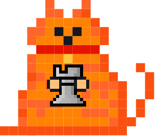
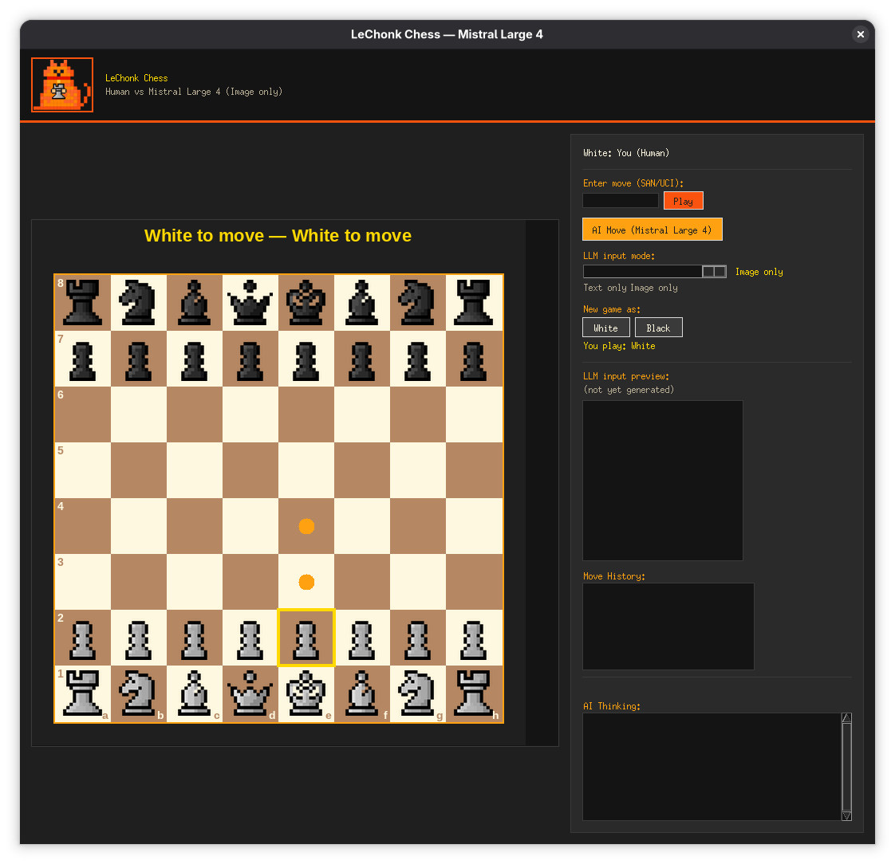

# LeChonk Chess

Play chess against **Mistral Large 4** — except the AI doesn't read the position
as text. It renders the board as an image and *looks at it* with a vision model,
then picks its move. You can play in a desktop app or in the terminal, and you
can even watch two instances of the AI play each other.



## Screenshots



[screenshot]

[screenshot]

## Video

[video]

## How it works

1. The current chess position is rendered as a PNG image of the board.
2. That image is sent to Mistral Large 4, which "sees" the board and replies
   with a move in standard chess notation.
3. The move is validated against the rules of chess and applied to the game.
   If the AI returns an illegal or unparseable move, it is asked to retry.
4. Repeat until checkmate, stalemate, or resignation.

You play as either color. The same engine also supports a **text-only mode**
(the board is described as text instead of an image) and a **hybrid mode**
(image + text), so you can compare how the model plays with and without vision.

## Ways to play

| Mode | Command | What it is |
|---|---|---|
| Desktop GUI | `uv run python gui.py` | Visual board, click-to-move, screenshot preview, move history |
| Vision CLI | `uv run python vision_game.py --new` | Human vs AI in the terminal, AI plays by vision |
| Text CLI | `uv run python text_game.py --new` | Human vs AI, text-only board (no images) |
| AI vs AI | `... --ai-vs-ai` | Watch Mistral Large 4 play against itself |
| Play as Black | add `--ai-white` | The AI takes White, you take Black |

The GUI also lets you switch the LLM input mode (text / image / hybrid) with a
slider and enter moves either by clicking squares or by typing SAN/UCI notation.

## Requirements

- Python 3.13+
- [uv](https://docs.astral.sh/uv/) (recommended) or pip
- A Mistral API key: `export MISTRAL_API_KEY='your-key'`

Install dependencies with:

```bash
uv sync        # or: pip install -e .
```

## Running the tests

```bash
uv run python test_chess.py
```

## Project layout

```
lechonkchess/
├── gui.py             Desktop app (tkinter): board, click-to-move, AI button
├── vision_game.py     Terminal game where the AI plays by vision
├── text_game.py       Terminal game where the AI plays from text only
├── chess_game.py      Game state and move validation (python-chess)
├── board_renderer.py  Renders positions as PNG images of the board
├── ai_player.py       Sends the board to Mistral Large 4 and parses its move
├── test_chess.py      Test suite
└── le-chonk-holding-rook.png   Project mascot
```

## Credits

This entire project was made by **Mistral Large 4** in **Mistral Vibe**.
